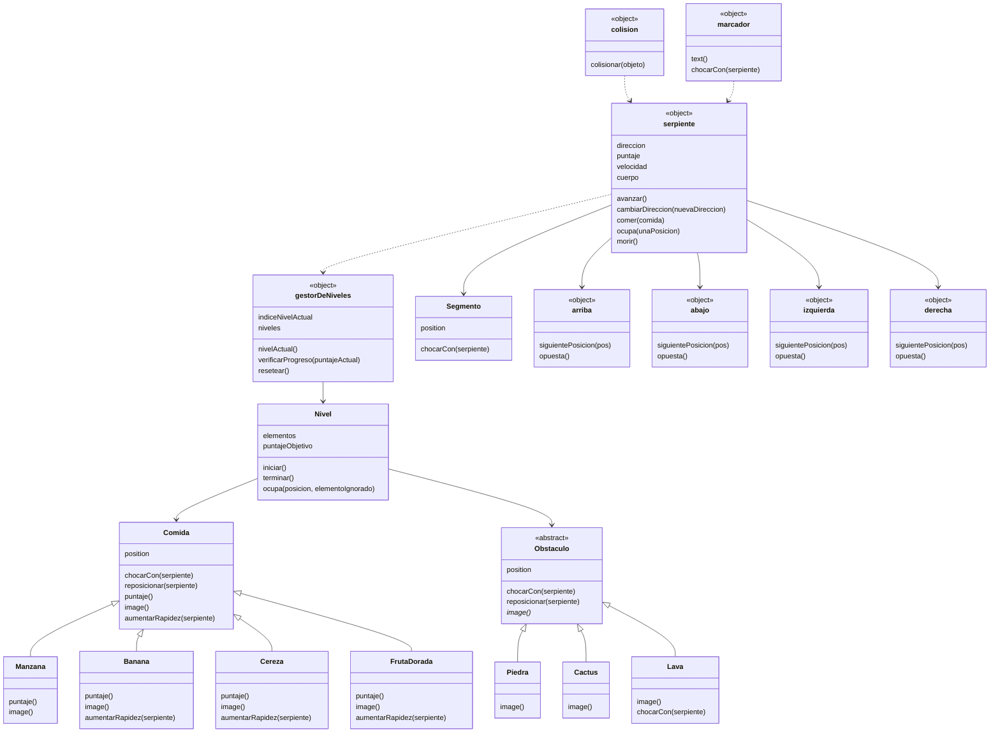

# Explicaciones del Modelo - Paradigma Orientado a Objetos

En este documento se detallan los conceptos del paradigma de objetos aplicados en el desarrollo del juego "Snake" utilizando Wollok, correspondientes a los Checkpoints 1 y 2.

## Checkpoint 1: Objetos, Polimorfismo y Eventos

### 1. Objetos Autodefinidos (WKO) vs Clases
La decisión entre usar Objetos Autodefinidos o instanciar Clases se basó en si necesitábamos una única entidad representativa o múltiples entidades con identidades separadas:
*   **Objetos Autodefinidos:** Utilizamos objetos como `serpiente`, `gestorDeNiveles`, `marcador` y `controles`. Dado que en nuestro dominio solo existe un jugador, un único flujo de niveles y un mapeo de teclas global, instanciarlos como objetos fijos simplifica el acceso (ej. `serpiente.puntaje()`) y evita variables globales innecesarias.
*   **Clases:** Creamos clases como `Nivel`, `Comida` y `Obstaculo`. Esto nos permite instanciar múltiples frutas (ej. dos manzanas en un mismo nivel) y diferentes niveles, cada uno manteniendo su propio estado interno.

### 2. Polimorfismo
El polimorfismo nos permitió tratar a distintos objetos de forma intercambiable mediante un mismo mensaje, ignorando sus diferencias internas. 
El mejor ejemplo en nuestro código es la resolución de colisiones en `juego.wpgm`. El bloque de Wollok Game `game.onCollideDo` simplemente le envía el mensaje `chocarCon(serpiente)` al objeto colisionado. 
*   Si el objeto es de la jerarquía `Comida`, la serpiente crece y suma puntos.
*   Si el objeto es un `Obstaculo` (Piedra, Cactus, Lava), cada uno implementa su propio castigo.
*   Si el objeto es un `Segmento` del cuerpo, la serpiente muere.
El motor del juego no necesita usar condicionales (`if`) para saber qué tipo de objeto pisó la serpiente; delega la responsabilidad a cada objeto.

### 3. Bloques (Lambdas) y Eventos
Los bloques de código aislaron el comportamiento que debía ejecutarse diferido en el tiempo o ante la interacción del usuario. 
*   **Eventos de Teclado:** En `controles.wlk`, usamos bloques junto a `onPressDo` para capturar la pulsación y enviar el mensaje `cambiarDireccion(...)` a la serpiente.
*   **Eventos Temporales:** Usamos `game.onTick(20, ...)` en `juego.wpgm` pasándole un bloque que ordena a la serpiente avanzar automáticamente.

---

## Checkpoint 2: Colecciones y Herencia

### 1. Colecciones
Usamos listas para modelar relaciones de uno a muchos y evitar código repetitivo:
*   **Segmentos de la Serpiente:** La serpiente conoce a todos los `Segmento` de su cuerpo guardándolos en la colección `cuerpo = []`. Al moverse, recorremos la lista (`forEach`) actualizando la posición de cada segmento a la posición del segmento anterior.
*   **Elementos del Nivel:** La clase `Nivel` posee una colección `elementos = []`. Usando `forEach`, el nivel recorre polimórficamente todos sus interactuables para agregarlos (`game.addVisual`) o quitarlos del tablero al terminar.

### 2. Herencia y Redefinición (Uso de `super`)
Para evitar la repetición de lógica común de reposicionamiento, dibujo y colisión, organizamos los interactuables en jerarquías. Creamos clases "base" (`Comida`, `Obstaculo`) de las cuales heredan objetos más específicos.

Implementamos una lógica interesante usando **redefinición con `super`** para extender el comportamiento heredado:
*   **En la Comida:** La clase base `Comida` define que `puntaje() = 10`. La subclase `Banana` hace un *override* de este método devolviendo `super() + 10` (total 20). Así reaprovecha el valor base y le suma su propio bono. Lo mismo ocurre con `Cereza` y `FrutaDorada`.
*   **En los Obstáculos:** La clase base `Obstaculo` define que al recibir `chocarCon(serpiente)` la serpiente muere. Sin embargo, la subclase `Cactus` hace un *override* total: no llama a `super`, sino que le resta 5 puntos y reduce su velocidad a la mitad, y luego se reposiciona. La `Lava` tampoco llama a `super`: resta 10 puntos y le quita un segmento del cuerpo a la serpiente. Esto demuestra cómo el polimorfismo permite que cada obstáculo tenga un efecto drásticamente distinto.

### Diagrama de Clases (UML)
A continuacion se ilustra la jerarquía y polimorfismo de los elementos del juego.

Polimorfismo: Comida, Obstaculo, Segmento y marcador entienden el mensaje chocarCon(serpiente). La colisión no pregunta de qué tipo es el objeto, solo le manda el mensaje.

Herencia y redefinición: Comida define el comportamiento base y cada fruta redefine puntaje(), image() y aumentarRapidez(). En Obstaculo, image() es abstracto, y las subclases como Cactus y Lava redefinen chocarCon para tener efectos únicos.

Objetos únicos (WKO): serpiente, gestorDeNiveles, colision, marcador y las cuatro direcciones son objetos porque no necesitan varias instancias. Nivel es clase porque tenemos cinco con distinta configuración.

Direcciones como objetos: cada dirección implementa siguientePosicion() y opuesta(), así la serpiente no usa ningún if para decidir hacia dónde se mueve (delegación pura).

Composición: gestorDeNiveles conoce a los Nivel, y cada Nivel conoce a sus Comida y Obstaculo. serpiente conoce a sus Segmento.